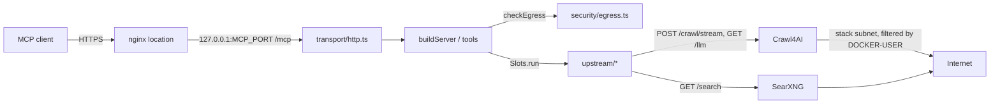

# searxng-crawl4ai-mcp design and deployment

## Overview

The server is a thin composition layer: SearXNG and Crawl4AI run as unmodified upstream images (Crawl4AI with a small login-profile hook), and all logic of this project lives in a Node/TypeScript MCP server that calls them over HTTP. Three containers make up the stack, deployed by Ansible from pinned image references in `versions.env`, behind an nginx location, with a host packet filter as the outbound security boundary. The external contract of the tools is in `docs/spec.md`.

## Design constraints and how they are enforced

| Constraint | Enforced by |
|---|---|
| Only `src/upstream/` speaks HTTP to the upstreams | ESLint `no-restricted-globals` (`fetch`) and `no-restricted-imports` (`undici`) outside `src/upstream/**` in `eslint.config.js`; `tests/unit/design-guards.test.ts` rejects `searxng:8080`, `crawl4ai:11235` or `fetch(` elsewhere in `src/` |
| No calls into scraping-library internals | `design-guards.test.ts` |
| Upstream image versions are declared only in `versions.env`, with immutable tags | `design-guards.test.ts`; the Ansible role `mcp_stack` also refuses a `CRAWL4AI_SESSION_IMAGE` tag that is not a 40-hex commit id |
| The production compose file never builds | `design-guards.test.ts` (no `build:` in `docker/compose.yaml`) |
| Retry timers are never detached (`unref`) | `design-guards.test.ts` |
| Crawl4AI is called only on the allowed endpoints and never receives `browser_config` | `design-guards.test.ts` |
| Both transports expose exactly `TOOL_NAMES` | `design-guards.test.ts` (boots `buildServer` over an in-memory transport) |
| The SearXNG settings define no engines of their own | `design-guards.test.ts` |
| No `any` | ESLint `@typescript-eslint/no-explicit-any` |

The server keeps no state: no cache, no database, no background jobs.

## Module layout

| Path | Responsibility |
|---|---|
| `src/index.ts` | Entry: `validateEnv`, apply the validated `LOG_LEVEL` to the logger (built at import with `info`, because pino throws on an unknown level before validation could report it), choose the transport, start the metrics listener (http only) |
| `src/server.ts` | `buildServer` registers the seven tools on a fresh `McpServer`; `TOOL_NAMES` |
| `src/tools/` | One file per tool plus `shared.ts` (fetch slots, outbound check, `guarded` wrapper that records metrics, `reply`) |
| `src/schemas/tools.ts` | zod input schemas |
| `src/transport/` | `http.ts` (listener, Host/Origin check, bearer auth) and `stdio.ts` |
| `src/security/` | `auth.ts` (bearer compare), `egress.ts` (`checkEgress`), `ranges.ts` (`DENIED_CIDRS`) |
| `src/upstream/` | `http.ts` (`request`, the only HTTP client), `retry.ts`, `searxng.ts`, `crawl4ai.ts`, `login-detect.ts`, `login-session.ts`, `types.ts` (normalised types; upstream shapes do not leak out) |
| `src/utils/` | `env.ts`, `errors.ts`, `format.ts`, `logger.ts` (pino to stderr with redaction), `semaphore.ts` (`Slots`) |
| `src/metrics/` | `registry.ts` (definitions), `record.ts` (the only recording API; never throws), `normalize.ts` (bounded labels), `server.ts` (listener) |
| `src/constants.ts` | Shared limits and timing constants |

Imports run `tools` → `upstream`/`security`/`schemas`/`metrics`/`utils`, and `transport` → `server` → `tools`. Two directory-level cycles exist and no rule forbids them: `metrics` ↔ `upstream` (`record.ts` imports `upstream/types`, `upstream/http.ts` imports `metrics/record`, `metrics/server.ts` imports `upstream/login-session`) and `utils` → `metrics` → `utils` (`semaphore.ts` records slot usage).

## Request flow

A tool validates input, runs `checkEgress` on target URLs, takes a fetch slot for page fetches, calls the upstream client, maps the result to normalised types, and renders it through `render` and `truncate` in `src/utils/format.ts`.

## Upstream client

`request` in `src/upstream/http.ts` is the single HTTP function. It sends `accept: application/json`, a bearer token when one is configured, and creates `AbortSignal.timeout` per attempt (default 120 seconds). It does not use `PROXY_URL`; the upstream containers do.

| Upstream | Call | Timeout | Retried |
|---|---|---|---|
| SearXNG | `GET /search?format=json&...` (`pageno` from 2) | 30 s | yes |
| Crawl4AI | `POST /crawl/stream` with `{urls, crawler_config}`, ndjson response | 120 s | yes (marked idempotent) |
| Crawl4AI | `GET /llm/{url}?q=` | 180 s | yes |

Pages are read through `/crawl/stream`, never `/md`: `/md` returns one status per call and loses a target's 404 behind a 502 carrying anti-bot text, while the stream returns a status and markdown per URL. Each workaround in `src/upstream/crawl4ai.ts` is pinned by a test in `tests/contract/tier-a/upstream.test.ts` that fails when its cause goes away.

Error mapping: Node network errors map to `unreachable` or `timeout` (`toFailure` in `src/utils/errors.ts`); upstream 401/403 map to `upstreamUnavailable`, other non-2xx to `httpError`; a non-JSON body is `upstreamUnavailable`. Crawl4AI per-URL results map 403/429 to `blocked`, other 4xx/5xx to `httpError`, the structural anti-bot veto to `httpError` ("no readable content") unless the page answered 2xx with content, other anti-bot messages to `blocked`, and timeout/DNS/connect messages to `timeout`/`unreachable`.

## Upstream retry policy

`withRetry` in `src/upstream/retry.ts` wraps `p-retry` with three stages, all of which must pass:

1. The request is idempotent (default: method `GET`).
2. The failure is transient (`retryReason`): `unreachable` → `connect`, `timeout` → `timeout`, HTTP 429 → `rate_limited`, 408/425 → `connect`, 500/502/503/504 → `http_5xx`. Anything else, including 501, `blocked` and `upstreamUnavailable`, is final.
3. Elapsed time plus the next wait (the larger of the backoff and `Retry-After`) stays within `RETRY_WAIT_BUDGET_MS` (2,000 ms, not configurable). A request that used up its own timeout fails this stage, so it is never retried.

Backoff: factor 2, `RETRY_MIN_WAIT_MS` 250 to `RETRY_MAX_WAIT_MS` 1,000, randomised. `Retry-After` accepts delta-seconds or an HTTP date. With attempts at 1 or less the wrapper is bypassed. Only retries actually performed are counted in `mcp_upstream_retries_total`. The budget is the whole guarantee (a retry never makes a call take more than 2 seconds longer than it would have without retries), and it is not configurable so that an operator cannot widen it until the guarantee stops holding.

## Search paging

`search` in `src/upstream/searxng.ts` reads result pages one after another until `limit` unique URLs are gathered, a page adds nothing new, `SEARCH_MAX_PAGES` is reached, or `SEARCH_TIME_BUDGET_MS` is spent (checked between pages). A failure on the first page propagates; a later failure ends the loop with what was gathered. When `engines` is given it is sent comma-joined and `categories` is omitted. The resulting `coverage` values are specified in `docs/spec.md`, "Tool web_search".

## Level-by-level crawl

Crawl4AI refuses `deep_crawl_strategy` from any HTTP caller and no token or setting changes that, so `web_crawl` (`src/tools/crawl.ts`) sequences the crawl itself and this is permanent: fetch a level, collect internal links, fetch the next level. A level larger than the remaining page budget is cut, which sets `stoppedAt` to `pages`. Each level is sent in sub-batches of `BATCH` URLs, each inside its own fetch slot.

## Readable versus raw markdown

`web_scrape` and degraded `web_extract` call `getMarkdown`, which sends `READABLE_CONFIG` (`DefaultMarkdownGenerator` with `PruningContentFilter`) and returns the `fit` markdown without links. The multi-document tools send `STREAM_CONFIG` and return `raw` markdown with links, because their callers need the links (crawl frontier, map) or the full text of several pages.

## Login session design

Goal: let the crawler fetch pages that need a sign-in, with the sign-in done once by a person in a real browser on the host, and no site credentials stored by this project.

Crawl4AI 0.9 refuses `user_data_dir`, `cookies` and `storage_state` sent over the network, so the Crawl4AI session image (`docker/crawl4ai/Dockerfile`) teaches the server to open one persistent profile itself:

- `docker/crawl4ai/session_profile.py` provides `wrap`, appended to `/app/egress_broker.py` around `enforce_egress`, the one function every route passes its browser config through. It replaces every config with one canonical persistent-context config on `C4AI_SESSION_PROFILE_DIR`, so the browser pool holds a single browser for the profile. With the variable empty it is a no-op. Build-time self-tests fail the build if the wrapped function disappears.
- The image records its Chromium version and user agent under `/opt/c4ai-session/` so the host browser can be checked against it.
- `docker/crawl4ai/crawl4ai-entrypoint.sh` runs the upstream entrypoint unchanged when `C4AI_SESSION_ROOT` is unset. Otherwise it refuses to start if `state/.session-root` is missing or a `login-in-progress` marker holds anything other than `resuming`, removes stale Chromium `Singleton*` files, and exports the profile directory.

The session store on the host (`mcp_login_session_root`, inside a mounted disk `mcp_login_session_mountpoint`) has `profile/` (uid 999, 0700), `state/` (0755) and the empty `state/.session-root` marker that proves the disk is mounted; Ansible never rewrites the marker. The overlay `docker/compose.login-session.yaml` mounts the store into crawl4ai at `/session` and `state/` read-only into the MCP container at `/run/login-state` (`LOGIN_STATE_DIR`).

The `login-session` script (`ansible/roles/mcp_stack/templates/login-session.sh.j2`, installed as `<mcp_deploy_dir>/login-session`, run as root):

| Command | Steps |
|---|---|
| `start` | Checks the store, the login user and the browser; refuses if the browser unit runs; compares the host browser's major version with the image's Chromium; writes marker `login`; stops crawl4ai; hands the profile to the login user; starts the host browser on the profile with the image's user agent as systemd unit `c4ai-login-browser`. Any error rolls back. |
| `stop` | Stops the browser unit; returns the profile to uid 999; writes marker `resuming`; starts crawl4ai and waits; clears the marker on success, or leaves `resuming` and exits 1. |
| `status` | Prints the marker, the browser unit state, the crawl4ai state and the profile owner. |

While the marker exists, the MCP server answers `loginInProgress`, the watchdog skips the container, and the entrypoint refuses to start unless the value is `resuming`. The detection of an expired login is in `docs/spec.md`, "Logged-in fetching".

## Container topology

`docker/compose.yaml` defines three services on the bridge network `stack` with subnet `STACK_SUBNET` (pinned so the packet filter matches) and no build steps:

| Service | Image variable | Exposure | Notes |
|---|---|---|---|
| `searxng` | `SEARXNG_IMAGE` | none | `docker/searxng/settings.yml` read-only; `cap_drop: ALL` plus four caps; proxy from `PROXY_URL` |
| `crawl4ai` | `CRAWL4AI_SESSION_IMAGE` | none | `shm_size` 1 GB; `mem_limit` and `memswap_limit` both `CRAWL4AI_MEM_LIMIT`; `cgroup_parent: mcpcrawl4ai.slice`; LLM provider from `GEMINI_MODEL` |
| `mcp` | `MCP_IMAGE` | `127.0.0.1:${MCP_PORT}:3000` | waits for both upstreams to be healthy; sets `SEARXNG_URL` and `CRAWL4AI_URL`; `MCP_TRANSPORT` is left unset (http) |

Overlays add to the base file and are chosen per host: `compose.metrics.yaml` (metrics listener on `0.0.0.0` in the container, published on host loopback), `compose.local-services.yaml` (opt-in loopback ports for SearXNG and Crawl4AI), `compose.login-session.yaml` (session store), `compose.dev.yaml` (builds the MCP image locally), and `compose.test.yaml` (contract-test fixture site, images built from the working tree, `SCRAPE_ALLOW_CIDRS` for the fixture subnet).

The MCP image (`Dockerfile`) builds with pnpm in one stage and runs `node dist/index.js` as user `node` in a second, with a health check on `GET /`. Only the package files, `tsconfig.json` and `src` enter the build.

## Pinned versions in versions.env

`versions.env` is the only place upstream and base image references are declared, each with an immutable tag. `MCP_IMAGE` and `CRAWL4AI_SESSION_IMAGE` carry the commit id of a CI build (`build-image.yml`); `CRAWL4AI_IMAGE` and `NODE_IMAGE` are build bases; `NGINX_IMAGE` is used only by the contract tests; `STACK_SUBNET` must agree between compose and the egress guard. A deployment changes versions by editing this file and rerunning the playbook; rolling back is restoring the file.

## Ansible deployment

`ansible/site.yml` runs on `mcp_hosts`, asserts the three vault secrets are at least 16 characters, then applies the roles `mcp_stack`, `egress_guard`, `nginx_proxy` and `observability` in that order. The playbook pulls images and never builds. The Gemini key is read from the repository-root `.env`; other secrets come from the vault.

Role `mcp_stack`:

- Chooses the compose file set: always the base, plus metrics, local-services and login-session when their variables are set.
- Copies individual files only (compose files, SearXNG settings, `versions.env`), never the working tree, and writes `.env` from `templates/env.j2` with mode 0600.
- Creates and validates the login-session store when `mcp_login_session_root` is set, and installs the `login-session` script.
- Installs the crawl4ai slice, the watchdog and the scheduled restart ("Crawl4AI memory and restarts").
- Pulls and starts the stack, then verifies: `GET /` answers 200, an unauthenticated `POST /mcp` answers 401, and the slice's `memory.swap.max` is 0.
- `mcp_max_concurrent_fetches` defaults to 4, the same as the server's own default; a low-power host lowers it in `host_vars`.

Role `nginx_proxy` drops a `location = /mcp-searxng-crawl4ai` snippet into an existing `locations.d` directory that proxies to `http://127.0.0.1:<mcp_port>/mcp` with buffering off and 600-second timeouts. The unauthenticated `/` route is not exposed. A snippet that `nginx -t` rejects is rolled back. TLS and the server block are outside this repository.

## Egress guard

The outbound security boundary is the role `egress_guard`, not the application check described in `docs/spec.md`, "Outbound request policy": a oneshot systemd unit `mcp-egress-guard` (bound to `docker.service`) that adds `iptables` rules to the `DOCKER-USER` chain dropping traffic from `STACK_SUBNET` to `10.0.0.0/8`, `172.16.0.0/12`, `192.168.0.0/16`, `169.254.0.0/16`, `127.0.0.0/8` and `100.64.0.0/10`. Allowed exceptions are inserted first as `RETURN`. Rules are added only if absent, so reruns are idempotent. The source subnet is read from `versions.env` at deploy time.

## Crawl4AI memory and restarts

Crawl4AI runs a browser whose memory must be bounded and which can stop answering while the container stays up, so three mechanisms keep it in check:

- Memory cap: `mem_limit` and `memswap_limit` are equal (default 2g), and the container runs in `mcpcrawl4ai.slice`, a systemd slice with `MemorySwapMax=0` installed by `mcp_stack`, so the cap holds through systemd reloads.
- Watchdog (`files/crawl4ai-watchdog.sh`, timer every `mcp_crawl4ai_watchdog_interval`): crawls an inline `raw:` HTML page inside the container and expects its marker text; after `mcp_crawl4ai_watchdog_failures` consecutive failures it restarts the container. It skips a stopped container, a container still starting, and any time the login marker exists.
- Scheduled restart (same script, mode `scheduled`, `OnCalendar` `mcp_crawl4ai_scheduled_restart_calendar`): restarts at most once per 20 hours, and only if no page fetch appeared in the container log during the last 10 minutes; otherwise it waits for the next slot.

## Observability

The role `observability` installs `observability/alloy/23-searxng-crawl4ai-mcp.alloy.j2` into an existing Alloy `config.d` and is skipped when Alloy is absent. The drop-in has no credentials and forwards into components defined by the host's main Alloy config:

- It scrapes the MCP metrics endpoint on host loopback (job `searxng-crawl4ai-mcp`, 15 s).
- A cAdvisor exporter limited to memory metrics of `/mcpcrawl4ai.slice` (job `searxng-crawl4ai-mcp-cgroup`) observes the crawl4ai memory cap.
- It reads container logs from the journal for the three stack containers. The compose files do not set a logging driver; the journald driver is expected from the host's Docker configuration.

The metric names are in `docs/spec.md`, "Metrics".

## CI and dependency updates

| Workflow | Trigger | Does |
|---|---|---|
| `.github/workflows/contract-test.yml` | every push, pull request | `static` (typecheck, lint, unit tests) → `tier-a` (gating contract tests, degraded run, login-session run) and `tier-b` (live internet, non-gating) |
| `.github/workflows/build-image.yml` | push to `main` (not docs-only), manual | Builds and pushes the MCP image and the Crawl4AI session image tagged with the commit id, and prints the `versions.env` lines to set |
| `.github/workflows/secret-scan.yml` | every push, pull request | secretlint and gitleaks |
| `.github/workflows/renovate.yml` | weekly, manual | Renovate with `renovate.json`: updates `*_IMAGE` lines in `versions.env`, groups SearXNG and Crawl4AI, ignores this project's own images, never automerges |

Pull requests opened by Renovate with the default token do not trigger the contract tests. Deploying a new build is a manual edit of `versions.env`.

## Tests

| Tier | Path | Runs | Needs |
|---|---|---|---|
| Unit | `tests/unit/` | `pnpm test` | nothing; includes `design-guards.test.ts` |
| Contract A (gating) | `tests/contract/tier-a/` | `pnpm test:contract:tier-a` | the stack with `compose.test.yaml` and `compose.metrics.yaml`; a local fixture site in `tests/fixtures/` |
| Contract B (non-gating) | `tests/contract/tier-b/` | `pnpm test:contract:tier-b` | the public internet; skips when engines or credentials are unavailable |
| Session | `tests/contract/session/` | `LOGIN_SESSION_CONTRACT=1` with `COMPOSE_ARGS` | the login-session overlay and a session store |

Tests use `node:test` through `tsx`. Contract tests talk to the real stack; nothing is mocked. The degraded `web_extract` contract runs as a separate step with `GEMINI_API_KEY` emptied.

## Client plugin and installers

`.claude-plugin/marketplace.json` and `plugins/searxng-crawl4ai-mcp/` package a client plugin that connects to the remote endpoint over HTTP with a bearer token taken from user configuration, plus a `crawl-search` skill. `install_claude_plugin.sh`, `install_claude_plugin.ps1` and `install_agy.sh` read `MCP_PUBLIC_ENDPOINT` and `MCP_PUBLIC_AUTH_TOKEN` (falling back to `MCP_AUTH_TOKEN`) from `.env`, probe the endpoint with an authenticated `tools/list`, and register the server with the client.

## References

- `eslint.config.js`, `tests/unit/design-guards.test.ts`: enforced design rules.
- `src/`: server code; `src/upstream/` for upstream calls and retry.
- `Dockerfile`, `docker/`: images, compose base and overlays, Crawl4AI session image, SearXNG settings.
- `versions.env`: pinned image references and the stack subnet.
- `ansible/`: playbook and the roles `mcp_stack`, `egress_guard`, `nginx_proxy`, `observability`.
- `observability/alloy/`: Alloy drop-in.
- `.github/workflows/`, `renovate.json`: CI and dependency updates.
- `tests/`: unit and contract tests and fixtures.
- `.claude-plugin/`, `plugins/`, `install_claude_plugin.sh`, `install_claude_plugin.ps1`, `install_agy.sh`: client plugin and installers.
